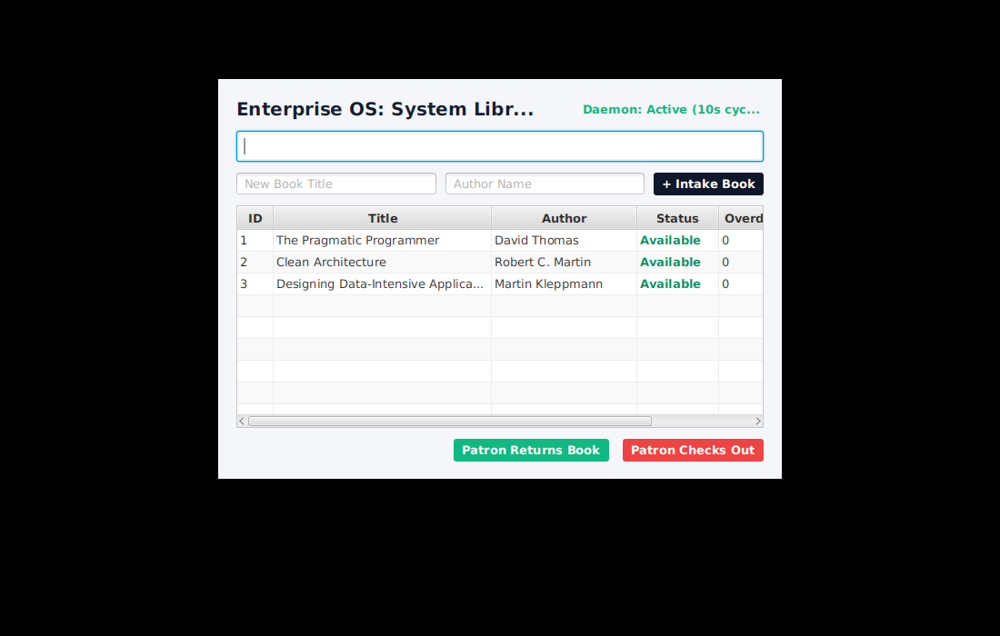
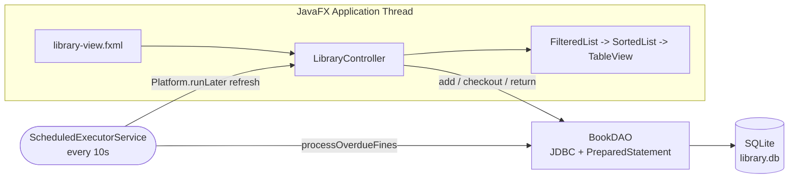

<div align="center">

# 🏛️ Enterprise Library OS

### Desktop library management system in JavaFX + SQLite

Catalog books, check them in and out, and let a background daemon accrue overdue fines without ever blocking the UI.

[](https://github.com/SlazzInC0de/Enterprise-Library-OS/actions/workflows/build.yml)




</div>

---

**Contents:** [Features](#-features) · [Architecture](#️-architecture) · [Tests](#-tests) · [Design decisions](#-design-decisions) · [Run locally](#-run-locally) · [Project structure](#-project-structure) · [Roadmap](#️-roadmap) · [Security and privacy](#-security-and-privacy) · [License](#-license)

---

## ✨ Features

- 📚 **Book intake**: add titles and authors straight into the catalog
- 🔁 **Checkout and return** with live status (Available / Borrowed)
- ⏱️ **Fine daemon**: a `ScheduledExecutorService` sweeps the database every 10 seconds (one simulated day) and adds ₹15 to each borrowed book
- 🔍 **Instant search**: a `FilteredList` predicate filters by title or author on every keystroke, with no database round trip
- ↕️ **Sortable columns** via `SortedList` bound to the table's comparator
- 💾 **Zero-config persistence**: SQLite file created and seeded on first launch

## 🏛️ Architecture



- **Thread safety**: the daemon writes on its own thread and hands UI refreshes back to the FX thread with `Platform.runLater`.
- **Clean shutdown**: closing the window stops the scheduler, so the JVM exits cleanly.
- **Injection-safe**: every write uses `PreparedStatement`.

## 🧪 Tests

19 JUnit 5 tests (9 DAO, 10 search) run on every push. DAO tests use a throwaway SQLite file, so the real `library.db` is never touched:

- seeding runs exactly once, and insert, checkout and return work end to end
- the overdue sweep charges only borrowed books and resets on return
- an unreachable database fails fast at startup, while later reads degrade to an empty list instead of crashing the UI
- search matches title or author, ignores case and surrounding spaces, and handles missing fields

**Coverage (JaCoCo, published in each CI run):**

| Layer | Line | Branch |
|---|---:|---:|
| `dao.BookDAO` | 96% | 83% |
| `model.Book`, `model.BookSearch` | 100% | 100% |
| JavaFX UI (`LibraryController`, `LibraryApplication`) | 0% | 0% |

The UI layer is thin glue around tested logic; search filtering was moved out of the controller into `BookSearch` specifically so it could be tested without a running JavaFX toolkit.

```bash
./mvnw verify      # tests + JaCoCo report in target/site/jacoco/
```

## 🧭 Design decisions

| Decision | Why | Trade-off / alternative |
|---|---|---|
| **SQLite, one connection per operation** | Zero setup for a single-user desktop app; short connections avoid long-held locks | No pooling; a server database would be needed for many concurrent users |
| **Read cursor closed before seeding** | SQLite cannot commit a write while a read cursor is open on the same file; seeding used to fail silently | Two round trips at startup |
| **Fine daemon on its own thread** | The UI never freezes during the sweep; results return via `Platform.runLater` | A 10-second "day" is a simulation; real due dates would replace it |
| **In-memory filtering** with `FilteredList` | Instant search on every keystroke, no query per key | Holds the whole catalog in memory; fine for thousands of titles, not millions |
| **Static DAO** | Simple for a small app | Harder to swap implementations; an interface plus injection would make the UI testable with fakes |
| **DB path from a system property** | Tests and users can point at any file without code changes | Not yet exposed in a settings screen |

## 🚀 Run locally

**Prerequisites:** JDK 17+. Maven is bundled via the wrapper.

```bash
git clone https://github.com/SlazzInC0de/Enterprise-Library-OS.git
cd Enterprise-Library-OS
./mvnw javafx:run          # Windows: mvnw.cmd javafx:run
```

The database file `library.db` is created in the working directory. Point it elsewhere with:

```bash
./mvnw javafx:run -Dlibrary.db.url=jdbc:sqlite:/path/to/library.db
```

## 📁 Project structure

```text
src/
├── main/java/com/example/librarymanagement/
│   ├── LibraryApplication.java   # JavaFX entry point
│   ├── Launcher.java             # plain main() for fat-JAR launches
│   ├── LibraryController.java    # UI logic, filtering, fine daemon
│   ├── dao/BookDAO.java          # SQLite access
│   └── model/                    # Book, BookSearch
├── main/resources/.../library-view.fxml
└── test/java/.../               # BookDAOTest, BookSearchTest
```

## 🗺️ Roadmap

- [ ] Patron records and borrowing history
- [ ] Due dates in real time instead of a simulated day
- [ ] Export the ledger to CSV
- [ ] Packaged installers with `jpackage`

## 🔒 Security and privacy

- Everything stays on your machine: no accounts, no network calls, just a local `library.db` file.
- Every write uses `PreparedStatement`, so book titles and authors cannot inject SQL.
- Found a vulnerability? Please report it privately as described in [SECURITY.md](SECURITY.md).

## 📄 License

MIT © [Suryansh Verma](https://github.com/SlazzInC0de)
